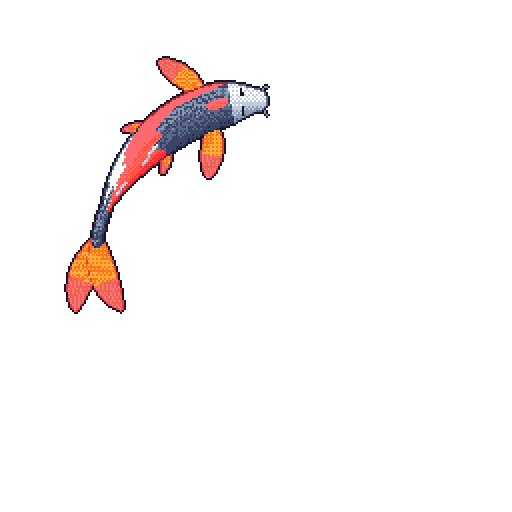

[Telegram](https://t.me/BlurryEclipse) · [GitHub](https://github.com/valinerosgordov) · [Steam](https://steamcommunity.com/id/valinerosgordov/)

I build **C#/.NET applications**, from Windows desktop software to integrations with physical devices. My interests include performance, local-first tools, AI, and XR.

## Selected work

### [.NET Performance Lab](https://github.com/valinerosgordov/dotnet-performance-lab)

Small, reproducible **BenchmarkDotNet experiments** with correctness checks and measured results. A place to test performance assumptions in code.

[Measured results](https://github.com/valinerosgordov/dotnet-performance-lab/tree/main/results) · [Experiments](https://github.com/valinerosgordov/dotnet-performance-lab/blob/main/Benchmarks.cs) · [Run locally](https://github.com/valinerosgordov/dotnet-performance-lab#run)

### [RFID + IRBIS](https://github.com/valinerosgordov/RFIDShkafWithIRBIS)

A library RFID terminal connecting **Windows software, the IRBIS library system, and Arduino-controlled locks**. An integration case study spanning application code and hardware.

`C#` · `.NET Framework 4.8` · `RFID` · `Arduino`

### [.NET Mastery Hub](https://github.com/valinerosgordov/NET-Mastery-Hub)

Engineering notes in Russian on **C#/.NET internals, performance, architecture, and distributed systems**.

Start reading: [low-latency .NET](https://github.com/valinerosgordov/NET-Mastery-Hub/blob/main/Performance/Senior/hft-low-latency.md) · [ThreadPool starvation](https://github.com/valinerosgordov/NET-Mastery-Hub/blob/main/Performance/Senior/threadpool-starvation-hill-climbing.md) · [zero-downtime migrations](https://github.com/valinerosgordov/NET-Mastery-Hub/blob/main/SQL/Senior/zero-downtime-migrations.md)

### [File Analysis — Flutter diploma project](https://github.com/valinerosgordov/diploma)

Local file analysis with **duplicate detection, ML Kit image classification, and PDF/Excel reports**. A mobile project exploring the intersection of file management and on-device ML.

`Dart` · `Flutter` · `ML Kit`

<strong>Archived case study: DailyPlanner</strong> — a shipped Windows app

 

[DailyPlanner](https://github.com/valinerosgordov/DailyPlanner) combines tasks, habits, a Pomodoro timer, and personal finances with local SQLite storage. Built with **.NET 10 and WPF**; the repository is **archived**.

[Release v3.44.0](https://github.com/valinerosgordov/DailyPlanner/releases/tag/v3.44.0) · [Windows installer](https://github.com/valinerosgordov/DailyPlanner/releases/download/v3.44.0/DailyPlanner-win-Setup.exe) · [Portable ZIP](https://github.com/valinerosgordov/DailyPlanner/releases/download/v3.44.0/DailyPlanner-win-Portable.zip)

## Toolbox

| Area | Technologies |
| :--- | :--- |
| .NET | C#, ASP.NET Core, WPF, EF Core, CommunityToolkit.Mvvm |
| Web & data | TypeScript, React, PostgreSQL, SQLite |
| AI | RAG, local LLMs, Ollama |
| XR | Unity, HLSL, ARCore, WebXR |
| Delivery | GitHub Actions, Docker |

Hackathon background

 

| Competition | Recognition | Focus |
| :--- | :--- | :--- |
| Microsoft Tech Challenge (UK) | Winner — Innovation | AR/VR |
| Cambridge CS Challenge | Best Project | VR |
| Udacity Challenge (UK) | Winner | High-performance code |
| Hack University | Best XR | Augmented reality |
| Chivas Challenge (Russia) | Winner | Creative technology |

<!-- activity-koi -->

## Activity Koi

My public GitHub activity, swimming in pixels. Updated daily with <a href="https://github.com/yalongwastaken/git-koi">git-koi</a>.

<!-- /activity-koi -->
